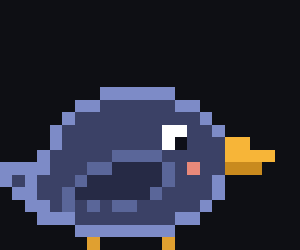
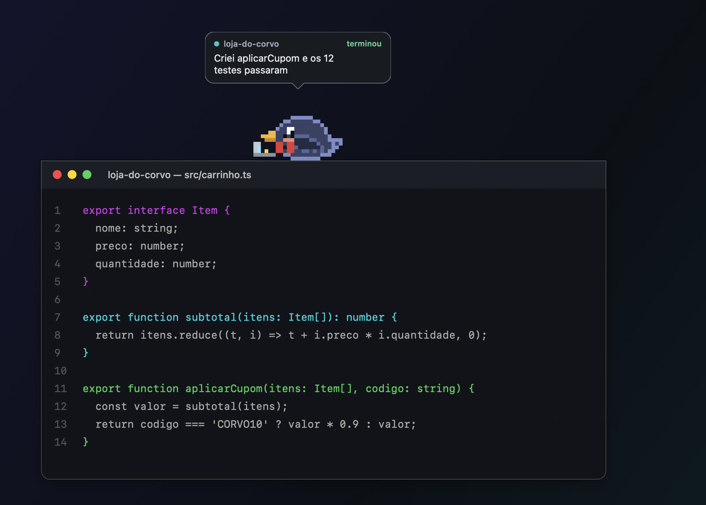
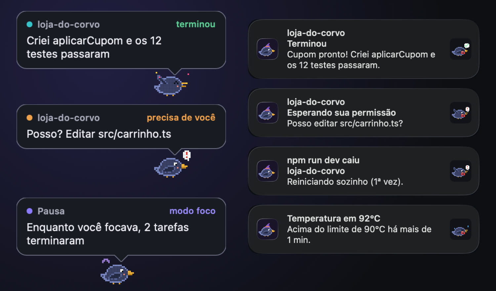
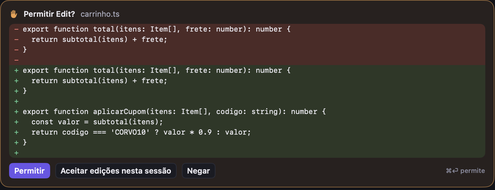
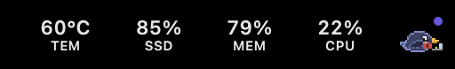
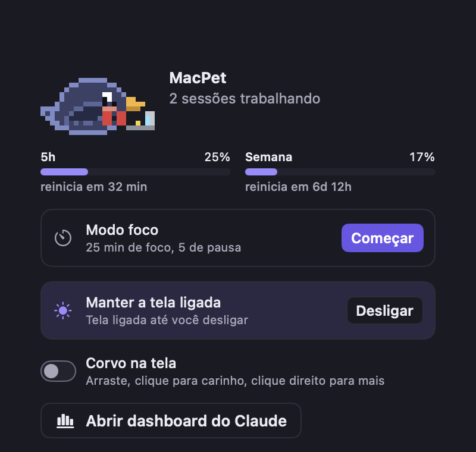
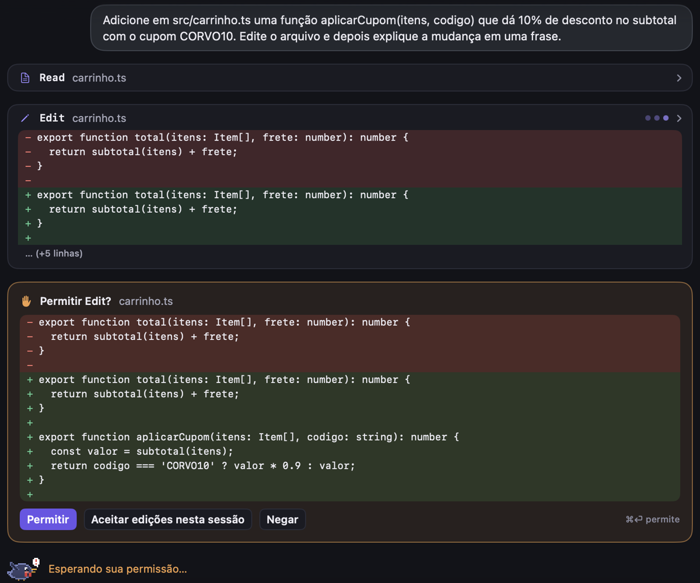
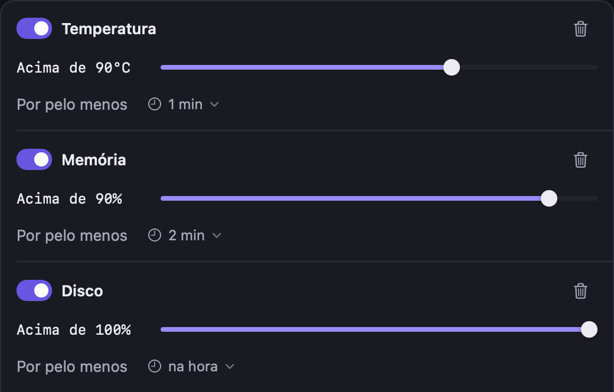
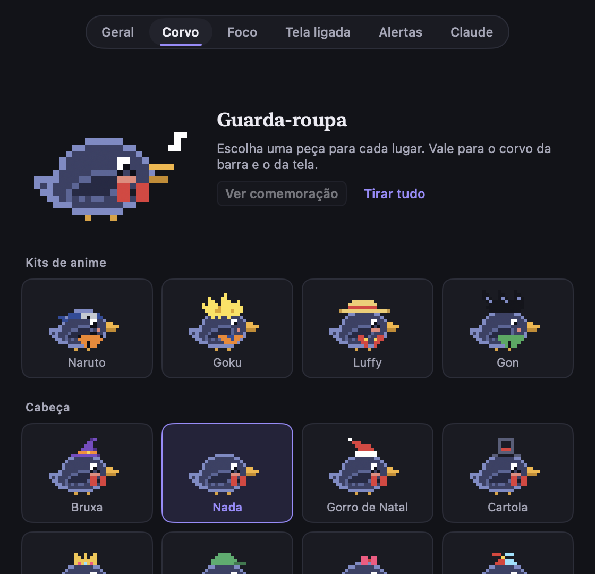

# MacPet

<p align="center"></p>

<p align="center"><b>Um corvo na barra de menus que vigia o Claude Code por você e cuida do seu Mac.</b><br>
Grátis, código aberto, nativo do macOS.</p>

<p align="center"></p>

Você pede algo ao Claude Code e vai fazer outra coisa. Quando ele termina, ou precisa de você, o corvo pousa na tela e avisa num balão. Sem ficar trocando de janela para ver se acabou.

```sh
brew tap PedroTatibanoWorkSpace/macpet https://github.com/PedroTatibanoWorkSpace/macpet
brew install --cask PedroTatibanoWorkSpace/macpet/macpet
```

Depois é só abrir, clicar no corvo da barra e em **Instalar hooks**. Outros jeitos de instalar estão em [Instalação](#instalação).

> Os prints abaixo são do app de verdade, com um projeto de exemplo (`loja-do-corvo`).

## Avisa quando o Claude termina ou precisa de você



- **Balão do corvo** com o projeto e o que aconteceu: *terminou*, *precisa de você* ou a pausa do *modo foco*. Um clique abre a conversa.
- **Notificações do Mac** com o som de cada projeto: tarefa pronta, pedido de permissão, servidor que caiu e o Mac esquentando.
- O corvo da barra muda de humor: bica o laptop enquanto o Claude trabalha, bate a asa quando espera você, comemora quando termina, fica tonto quando o Mac esquenta e dorme quando não há nada acontecendo.

## Aprove sem trocar de janela



Antes de mexer no seu código, o Claude mostra o diff e pede permissão. Você responde ali mesmo: **Permitir**, **Aceitar edições nesta sessão** ou **Negar**.

## Limites do plano e sessões num clique

<p></p>


Temperatura, disco, memória e CPU na barra. Um clique no corvo mostra quanto do limite de 5h e da semana do Claude já foi, quantas sessões estão rodando, o modo foco e a tela sempre ligada.

## Todos os projetos num lugar só



- **Chat nativo com o Claude Code** por projeto: texto em tempo real, cartões de ferramenta com diff, permissões, modo e modelo, retomar conversas.
- **Alterações**: diff colorido, preparar e descartar, commit com mensagem escrita pelo Claude no padrão do repositório, separar em commits lógicos, branch, push e PR.
- **Revisão do PR**: o Claude revisa tudo o que entra no PR lendo o código em volta, e cada achado tem "Corrigir no chat".
- **Terminais** com os comandos do projeto, que continuam rodando ao trocar de projeto. Mostram as portas abertas, avisam quando um servidor cai e podem reiniciá-lo sozinho.
- **Tarefas paralelas**: o Claude divide um trabalho em partes, cada uma numa cópia separada do repositório (git worktree) com um agente próprio.
- **Dashboard do Claude Code**: custo e tokens por dia, projeto e modelo, histórico de sessões com busca, biblioteca de prompts e configuração (CLAUDE.md, permissões, plugins, MCPs, skills, hooks).
- ⌘1…⌘9 trocam de projeto. Projetos que você não usa agora podem ser arquivados.

## Seu Mac também tem voz



Regras como "temperatura acima de 90°C por 1 minuto". Passou do limite, o item fica vermelho na barra e chega uma notificação. Gráficos da última hora, 24h e 7 dias e os processos que mais consomem, com opção de encerrar.

E mais: **modo foco** (pomodoro com o corvo, que cochila e segura as notificações que podem esperar até a pausa), **tela ligada** na hora ou em horários programados e **modo limpeza** (apaga a tela e desliga o teclado para limpar o Mac).

## E ainda é divertido



O corvo pode morar na tela: anda pelo chão e por cima das janelas, voa atrás do cursor, deixa você fazer carinho e troca de roupa (Naruto, Goku, Luffy, Gon e mais). No **Samba do Corvo** (menu do corvo › Tocar samba) você toca uma batucada com A S D F enquanto ele dança.

## Privacidade e leveza

- **Nenhuma porta de rede, nenhum servidor, nenhuma telemetria**: o MacPet conversa com o Claude Code só por um socket local em `~/.macpet`, acessível apenas pelo seu usuário. O que vai para a internet é só o que o próprio Claude Code já envia.
- **Hooks com backup**: ao instalar, os hooks entram em `~/.claude/settings.json`, e o arquivo original é guardado antes.
- **Leve**: nativo em Swift, fica abaixo de 1% de CPU quando não há nada acontecendo.
- **Código aberto** sob a licença MIT.

## Instalação

**Pelo Homebrew** (o jeito mais fácil, sem compilar; macOS 14 ou mais novo):

```sh
brew tap PedroTatibanoWorkSpace/macpet https://github.com/PedroTatibanoWorkSpace/macpet
brew install --cask PedroTatibanoWorkSpace/macpet/macpet
```

**Baixando o app:** pegue o `MacPet-x.y.z.zip` em [Releases](https://github.com/PedroTatibanoWorkSpace/macpet/releases), descompacte e arraste para Aplicativos. O app não é assinado por uma conta paga de desenvolvedor Apple, então na primeira abertura o macOS bloqueia: vá em **Ajustes › Privacidade e Segurança** e clique em **Abrir mesmo assim**.

**Compilando o código** (precisa de Swift 6.2, que vem com as Command Line Tools do Xcode 26, no macOS 15.6 ou mais novo):

```sh
git clone https://github.com/PedroTatibanoWorkSpace/macpet.git
cd macpet
./scripts/setup-signing.sh   # uma vez: as permissões do macOS sobrevivem às atualizações
make install                 # compila, instala em /Applications e abre
```

O guia completo, com primeira abertura, atualização, desinstalação e problemas comuns, está em **[docs/INSTALACAO.md](docs/INSTALACAO.md)**.

Depois de abrir, clique no corvo da barra e em **Instalar hooks** para conectar ao Claude Code.

## Desenvolvimento

Requer só as Command Line Tools do Xcode 26 (Swift 6.2).

```sh
make run       # compila dist/MacPet.app e abre
make install   # instala em /Applications
```

Simular um evento do Claude Code:

```sh
echo '{"hook_event_name":"Stop","session_id":"x","cwd":"'$PWD'"}' | ~/.macpet/bin/macpet-hook
```

## Release

Para publicar uma versão, crie uma tag `vX.Y.Z` e faça push. O GitHub Actions compila o app universal (arm64 + x86_64), publica a Release e atualiza `Casks/macpet.rb`.

## Como funciona

| Parte | Fonte |
|---|---|
| CPU / memória | `host_statistics` (mesmo cálculo do Monitor de Atividade) |
| Temperatura | sensores `PMU tdie*` via IOHIDEventSystem (API privada) |
| Rede | contadores da interface principal (`getifaddrs`) |
| Histórico | SQLite em `~/Library/Application Support/MacPet` |
| Claude Code (eventos) | hooks → `macpet-hook` → Unix socket `~/.macpet/macpet.sock` |
| Limites do plano | statusLine → `macpet-hook statusline` (campo `rate_limits`) |
| Uso e histórico | índice incremental dos transcripts `~/.claude/projects/**/*.jsonl` em SQLite |
| Chat dos projetos | `claude -p --input-format stream-json --output-format stream-json --permission-prompt-tool stdio` |
| IA do git | `claude -p` enxuto (sem ferramentas, hooks nem sessão salva) com Haiku/Sonnet |
| Terminal | [SwiftTerm](https://github.com/migueldeicaza/SwiftTerm) |

## Roadmap

1. ~~Monitor, alertas, histórico e pet com notificações do Claude~~
2. ~~Dashboard do Claude: tokens e custo, limites do plano, histórico de conversas, configuração, launcher e prompts salvos~~
3. ~~Hub de projetos: chat nativo, alterações/commits com IA e terminal~~
4. Versão para Windows 11 (**Cawde**, Tauri + Rust), em desenvolvimento na branch [`windows`](https://github.com/PedroTatibanoWorkSpace/macpet/tree/windows). Ainda não está pronta para instalar.

## Licença

[MIT](LICENSE).
